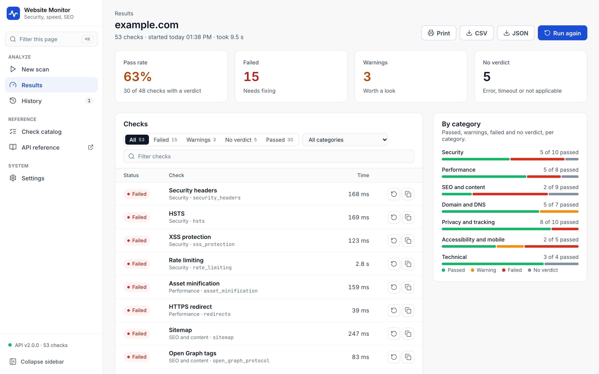

# Website Monitor

[](https://github.com/fabriziosalmi/websites-monitor/actions/workflows/ci.yml)
[](LICENSE)

Website Monitor runs 53 checks against a website: TLS, security headers, performance, SEO, DNS, privacy and accessibility. It has a web UI, a REST API, a command line, an MCP server for AI assistants, and a scheduler that writes a Markdown report for a list of sites.

<picture>
  <source media="(prefers-color-scheme: dark)" srcset="docs/screenshot-dark.png">
  
</picture>

## Contents

- [Quick start](#quick-start)
- [Web UI](#web-ui)
- [Verdicts](#verdicts)
- [Checks](#checks)
- [Interfaces](#interfaces)
- [REST API](#rest-api)
- [Command line](#command-line)
- [MCP server](#mcp-server)
- [Architecture](#architecture)
- [Scheduled reports](#scheduled-reports)
- [Configuration](#configuration)
- [Development](#development)

## Quick start

With Docker Compose:

```bash
git clone https://github.com/fabriziosalmi/websites-monitor.git
cd websites-monitor
cp .env.example .env        # optional keys, address and port
docker compose up -d --build
```

Open http://127.0.0.1:8000/ for the web UI. The API answers on the same port; its interactive reference is at http://127.0.0.1:8000/api/docs.

Compose starts two containers, each limited to 256 MB of memory:

- `website-monitor-api`: the REST API and the web UI.
- `website-monitor-scheduler`: runs every check against the sites in `config.yaml` every `MONITOR_INTERVAL` seconds and writes `reports/report.md`.

By default the port is published on 127.0.0.1 only. To reach it from other machines, set `WM_BIND_ADDRESS` (an address of the host, or `0.0.0.0`) and `WM_PORT` in `.env`.

The API has no authentication, and its checks send requests to whatever host they are given, including hosts on your internal network. Publish it only on a trusted network or behind an authenticating reverse proxy; see [SECURITY.md](SECURITY.md).

Without Docker, with Python 3.11:

```bash
pip install -r requirements.txt
python api.py               # API and web UI on http://127.0.0.1:8000/
python main.py              # one run over config.yaml, writes report.md
```

## Web UI

The web UI is a static page in `docs/`, served by the API under `/docs/` (`/` redirects there).

- **New scan**: a domain or URL (only the host is used) and the checks to run, all 53 by default.
- **Results**: each check runs as its own request, four at a time, so results appear as they finish. The page shows the pass rate, the number of failed checks, warnings and checks without a verdict, a breakdown per category, and the list of checks with filters and search. A single check can be run again, and the `curl` command for it copied. Results export to CSV and JSON.
- **History**: the last 20 scans, kept in the browser's local storage.
- **Check catalog**: every check with its ID, category and description.
- **Settings**: the API address, the timeout per check, how many checks run in parallel, an optional PageSpeed key (kept in memory for the current tab only), the theme (light, dark or system) and the language.

The interface is in English and Italian. By default it follows the browser's language; Settings can fix it to either. The text the checks return, such as `50 days left` or an error message, comes from the API and stays in English.

The same page is published on GitHub Pages at https://fabriziosalmi.github.io/websites-monitor/. There it has no API behind it: set the address of a running API in Settings. A page served over HTTPS can only call an API served over HTTPS.

## Verdicts

Every check returns a verdict, sometimes followed by a detail in parentheses, such as `(50 days left)`. The API returns the verdict as a coloured circle at the start of the `result` string:

| Symbol | Verdict | Meaning |
|---|---|---|
| U+1F7E2 green circle | Pass | The site meets the check. |
| U+1F7E1 yellow circle, U+1F7E0 orange circle | Warning | Partly met, or worth a look. |
| U+1F534 red circle | Fail | The site does not meet the check. |
| U+26AA white circle | No verdict | The check could not decide: an error, a timeout, a missing API key, or nothing to check. The detail says why when the check knows, for example `(no PageSpeed API key)`. |

The pass rate in the web UI is the share of passed checks among those with a verdict; checks without a verdict are left out.

## Checks

Some checks need a key to give a verdict; without it they return no verdict and name the key:

- `pagespeed_performances` needs `PAGESPEED_API_KEY`. The score is mapped onto Lighthouse's bands: 90 to 100 pass, 50 to 89 warning, 0 to 49 fail.
- `data_leakage` needs `GITHUB_TOKEN` (GitHub code search requires authentication).
- `accessibility` uses Lighthouse through the PageSpeed API, then the WAVE API if `WAVE_API_KEY` is set, and otherwise its own heuristics on the page HTML; a heuristic result is marked `(heuristic)`.
- `browser_compatibility` loads the page in Chrome and Firefox through Selenium. The Docker image ships no browser, so there it returns `(no browser available)`.
- `dns_blacklist` checks the IPv4 address the domain resolves to. Behind a CDN that is the CDN's address.

<details>
<summary>All 53 checks</summary>

**Security** (10)

| Check | ID | What it looks at |
|---|---|---|
| SSL certificate | `ssl_cert` | Validity and days to expiry |
| TLS cipher strength | `ssl_cipher_strength` | Negotiated cipher suite |
| Security headers | `security_headers` | CSP, X-Frame-Options and others |
| HSTS | `hsts` | Strict-Transport-Security header |
| XSS protection | `xss_protection` | X-XSS-Protection header |
| CORS policy | `cors_headers` | Cross-origin response headers |
| Mixed content | `mixed_content` | HTTP resources on HTTPS pages |
| Subresource integrity | `subresource_integrity` | SRI on external scripts and styles |
| Rate limiting | `rate_limiting` | Response to a burst of requests |
| Data leakage | `data_leakage` | Mentions in public GitHub code |

**Performance** (8)

| Check | ID | What it looks at |
|---|---|---|
| PageSpeed score | `pagespeed_performances` | Google PageSpeed Insights |
| Load time | `website_load_time` | Total time to load the page |
| Server response time | `server_response_time` | Time to first byte |
| Brotli compression | `brotli_compression` | Content-Encoding: br |
| Asset minification | `asset_minification` | CSS and JavaScript minified |
| CDN | `cdn` | Content delivery network in front |
| Redirect chains | `redirect_chains` | Number of hops to the final URL |
| HTTPS redirect | `redirects` | HTTP redirects to HTTPS |

**SEO and content** (9)

| Check | ID | What it looks at |
|---|---|---|
| Sitemap | `sitemap` | sitemap.xml present and valid |
| robots.txt | `robot_txt` | Present and well formed |
| Open Graph tags | `open_graph_protocol` | Social sharing metadata |
| Image alt text | `alt_tags` | Every image has an alt attribute |
| Semantic markup | `semantic_markup` | Structured data in the page |
| Canonical URL | `url_canonicalization` | rel="canonical" link |
| Favicon | `favicon` | Site icon present |
| Broken links | `broken_links` | Internal links that fail |
| External links | `external_links` | Outbound links reachable |

**Domain and DNS** (7)

| Check | ID | What it looks at |
|---|---|---|
| Domain expiration | `domain_expiration` | Registration expiry date |
| DNSSEC | `dnssec` | Signed DNS zone |
| DNS blocklists | `dns_blacklist` | Listed on DNS-based blocklists |
| Breach exposure | `domain_breach` | Domain in known data breaches |
| Domain blocklists | `domainsblacklists_blacklist` | Aggregated threat lists |
| Subdomains | `subdomain_enumeration` | Common subdomains that resolve |
| Email records | `email_domain` | SPF and mail records |

**Privacy and tracking** (10)

| Check | ID | What it looks at |
|---|---|---|
| Cookie policy | `cookie_policy` | Policy page linked |
| Cookie flags | `cookie_flags` | Secure and HttpOnly set |
| Cookie duration | `cookie_duration` | Session cookie lifetimes |
| Cookie SameSite | `cookie_samesite_attribute` | SameSite attribute set |
| Ads and tracking | `ad_and_tracking` | Analytics and ad scripts |
| FLoC opt-out | `floc` | interest-cohort permission policy |
| Privacy exposure | `privacy_exposure` | Sensitive data in the page |
| WHOIS privacy | `privacy_protected_whois` | Registrant data redacted |
| Third-party requests | `third_party_requests` | Requests to other domains |
| Third-party resources | `third_party_resources` | Scripts and styles from other domains |

**Accessibility and mobile** (5)

| Check | ID | What it looks at |
|---|---|---|
| Accessibility | `accessibility` | Accessibility score |
| Mobile friendly | `mobile_friendly` | Viewport and responsive layout |
| AMP | `amp_compatibility` | AMP version available |
| Internationalization | `internationalization` | lang and hreflang attributes |
| Browser compatibility | `browser_compatibility` | Markup older browsers handle |

**Technical** (4)

| Check | ID | What it looks at |
|---|---|---|
| Content-Type header | `content_type_headers` | MIME type and charset |
| CMS detection | `cms_used` | Platform behind the site |
| Client-side rendering | `clientside_rendering` | Content rendered by JavaScript |
| Deprecated libraries | `deprecated_libraries` | Outdated JavaScript libraries |

</details>

## Interfaces

The same operations are available four ways. The REST API, the command line and the MCP server return the same JSON for the same operation; the web UI calls the REST API.

| Operation | REST API | Command line | MCP tool | Web UI |
|---|---|---|---|---|
| health | `GET /health` | `websites-monitor health` | `health` | sidebar |
| list_checks | `GET /checks` | `websites-monitor checks` | `list_checks` | Check catalog |
| run_check | `GET /check/{id}?website=` | `websites-monitor check <id> <website>` | `run_check` | Run again, on a result row |
| scan | `POST /monitor/single` | `websites-monitor scan <website>` | `scan` | New scan, Results, JSON export |
| scan_many | `POST /monitor` | `websites-monitor scan-many <website>...` | `scan_many` | |
| report | `POST /generate-report` | `websites-monitor report <website>...` | `report` | |

Each check result carries `verdict` (`pass`, `warn`, `fail` or `unknown`) and `detail`, so a client does not need to read the symbols. A scan also returns a `summary` with the counts and the pass rate.

## REST API

The API is a FastAPI application. `website` accepts a domain or a URL; only the host is used. The interactive reference is served at `/api/docs` (Swagger UI) and `/api/redoc`, and the OpenAPI description at `/api/openapi.json`.

| Method and path | What it does |
|---|---|
| `GET /health` | Status, version and number of checks. |
| `GET /checks?category=` | The checks: ID, name, category, description and endpoint. `category` is optional. |
| `POST /monitor/single` | Runs the listed checks (all of them when `checks` is omitted) against one website. Each check runs once, in the order given. |
| `GET /monitor/single?website=` | Runs every check against one website; same response as the POST. |
| `GET /check/{id}?website=` | Runs one check. |
| `POST /monitor` | Runs every check against several websites; results are grouped by check. |
| `POST /monitor/async` | Same, in the background: returns a task ID. HTTP only. |
| `GET /monitor/async/{task_id}` | Status and result of a background task. Tasks live in memory and are lost on restart. |
| `POST /generate-report` | Runs every check and returns a report as JSON, Markdown or HTML (`output_format`). |

Run three checks against one site:

```bash
curl -s -X POST http://127.0.0.1:8000/monitor/single \
  -H 'Content-Type: application/json' \
  -d '{"website": "example.com", "checks": ["ssl_cert", "hsts", "pagespeed_performances"]}'
```

```json
{
  "success": true,
  "message": "Custom monitoring completed successfully",
  "website": "example.com",
  "results": [
    {
      "check_id": "ssl_cert",
      "check_name": "SSL certificate",
      "category": "security",
      "website": "example.com",
      "result": "\ud83d\udfe2 (50 days left)",
      "verdict": "pass",
      "detail": "50 days left",
      "status": "completed",
      "error": null,
      "timestamp": "2026-11-05T11:36:23.064392+00:00",
      "duration_ms": 53
    },
    {
      "check_id": "hsts",
      "check_name": "HSTS",
      "category": "security",
      "website": "example.com",
      "result": "\ud83d\udd34",
      "verdict": "fail",
      "detail": "",
      "status": "completed",
      "error": null,
      "timestamp": "2026-11-05T11:36:23.083954+00:00",
      "duration_ms": 72
    },
    {
      "check_id": "pagespeed_performances",
      "check_name": "PageSpeed score",
      "category": "performance",
      "website": "example.com",
      "result": "\u26aa (no PageSpeed API key)",
      "verdict": "unknown",
      "detail": "no PageSpeed API key",
      "status": "completed",
      "error": null,
      "timestamp": "2026-11-05T11:36:23.012356+00:00",
      "duration_ms": 1
    }
  ],
  "summary": {
    "total": 3,
    "passed": 1,
    "warnings": 0,
    "failed": 1,
    "no_verdict": 1,
    "pass_rate_percent": 50
  },
  "execution_time": 0.073,
  "timestamp": "2026-11-05T11:36:23.084009+00:00",
  "websites_checked": 1,
  "checks_performed": 3
}
```

`result` is the check's own string, starting with the verdict symbol (shown here as JSON escapes; see [Verdicts](#verdicts)). When a check raises an error or exceeds its timeout, `status` is `error`, `verdict` is `unknown` and `error` holds the message, for example `Timed out after 30s`. An unknown check ID comes back with `"error": "Unknown check"`.

Optional request fields: `timeout` (5 to 300 seconds, default 30) limits each check, `concurrency` (1 to 16, default 4) sets how many checks run at once, and `pagespeed_api_key` overrides `PAGESPEED_API_KEY` for one request.

## Command line

```bash
python -m websites_monitor scan example.com                # all checks, text output
python -m websites_monitor scan example.com --checks ssl_cert,hsts --json
python -m websites_monitor check ssl_cert example.com
python -m websites_monitor checks --category security
python -m websites_monitor report example.com example.org --format html --output report.html
python -m websites_monitor serve --port 8000               # REST API and web UI
```

In the Docker image the same command is `websites-monitor`. Run it in a container of its own rather than inside the API container, where it would share the API's 256 MB:

```bash
docker run --rm --memory 256m ghcr.io/fabriziosalmi/websites-monitor:latest websites-monitor scan example.com
```

Without `--json` the output is a line per check (`PASS`, `WARN`, `FAIL` or `----` for no verdict) and a summary. With `--json` it is the JSON the REST API returns for the same operation. The checks' own log lines are hidden unless you pass `-v`.

Exit codes: `0` done; `1` when `--fail-on fail` (or `--fail-on warn`) is given and a check failed (or failed or warned), which makes the command usable as a CI gate; `2` bad usage; `3` the operation could not run (a website that is not a host, an unknown check).

## MCP server

The MCP server lets an AI assistant run the checks itself. It has one tool per operation (`health`, `list_checks`, `run_check`, `scan`, `scan_many`, `report`), returning the same JSON as the REST API. `run_check`, `scan`, `scan_many` and `report` are marked as read only but open world: they change nothing locally and send requests to the websites they are given.

Over stdio, for an assistant on the same machine:

```bash
python -m websites_monitor mcp
```

With Docker, an MCP client can start the server in a container of its own for each session. A client configuration in the usual `mcpServers` format:

```json
{
  "mcpServers": {
    "websites-monitor": {
      "command": "docker",
      "args": [
        "run", "--rm", "-i", "--memory", "256m",
        "-v", "websites-monitor-cache:/tmp/websites-monitor",
        "ghcr.io/fabriziosalmi/websites-monitor:latest",
        "websites-monitor", "mcp"
      ]
    }
  }
}
```

The volume keeps the 107 MB domain blacklist between sessions: the first scan that needs it downloads it (about 20 seconds), later ones read it from the volume. A separate container also keeps the MCP server from sharing the memory of a running API container: the API takes about 80 MB and a process that loads the checks about 50 MB more, and in CI an MCP session started inside the API container, while the domain blacklist was downloading, was killed for lack of memory.

Over HTTP: `python -m websites_monitor mcp --transport streamable-http --port 8001`, then point the client at `http://127.0.0.1:8001/mcp`. Like the REST API, it has no authentication; see [SECURITY.md](SECURITY.md).

## Architecture

The code in `websites_monitor/` is laid out as ports and adapters:

- `domain.py`: verdicts, targets and summaries, without I/O.
- `application.py`: `MonitorService`, the one implementation of every operation, and the report rendering.
- `ports.py`: the `CheckRunner` interface the application needs.
- `adapters/checks.py`: the check runner over the functions in `checks/`, and the registry of checks (ID, category, name, minimum timeout).
- `adapters/http.py`, `adapters/cli.py`, `adapters/mcp.py`: the REST API, the command line and the MCP server. Each translates its protocol to a `MonitorService` call and nothing else.

`api.py` and `main.py` are kept as entry points for Docker Compose, the scheduler and the GitHub Action. `tests/test_parity.py` runs every operation through the three interfaces on the same input and fails if their JSON differs, if an interface lacks an operation, or if the web UI's JSON export drifts from the API's `scan` response.

## Scheduled reports

`main.py` runs every check against the `websites` in `config.yaml` and writes a Markdown table, one row per site, to `output_file`. It exits with status 1 when it cannot produce the report.

- **Docker**: the scheduler container runs `main.py` every `MONITOR_INTERVAL` seconds and writes `reports/report.md`.
- **GitHub Actions**: `.github/workflows/create-report.yml` runs `main.py` daily at 04:00 UTC and commits `report.md`. GitHub disables scheduled workflows in repositories without recent activity; enable it from the Actions tab of your fork. Set the `PAGESPEED_API_KEY` repository secret for the PageSpeed check.

## Configuration

`config.yaml`, read by `main.py` and the scheduler:

| Key | Default | Meaning |
|---|---|---|
| `websites` | | Domains or URLs to check. |
| `timeout` | `30` | Seconds each check may take. |
| `output_file` | `report.md` | Where the report is written. The `OUTPUT_FILE` variable overrides it. |
| `report_template` | `report_template.md` | Optional text placed above the table. |

Environment variables (see `.env.example`):

| Variable | Used by | Meaning |
|---|---|---|
| `WM_BIND_ADDRESS`, `WM_PORT` | Docker Compose | Address and port where the API is published. Default `127.0.0.1` and `8000`. |
| `PAGESPEED_API_KEY` | `pagespeed_performances`, `accessibility` | Google PageSpeed Insights API key. |
| `GITHUB_TOKEN` | `data_leakage` | GitHub token for code search. |
| `WAVE_API_KEY` | `accessibility` | WAVE API key. |
| `MONITOR_INTERVAL` | scheduler | Seconds between two runs. Default 3600. |
| `OUTPUT_FILE` | `main.py` | Report path, overriding `config.yaml`. |
| `API_HOST`, `API_PORT` | `python api.py` | Listen address and port. Default `0.0.0.0` and `8000`. |
| `API_RELOAD` | `python api.py` | `1` restarts the server on code changes. Development only: a restart drops requests in progress. |
| `WM_CACHE_DIR` | `domainsblacklists_blacklist` | Where the 107 MB domain blacklist is cached. Default: a `websites-monitor` directory in the system temp directory. |

## Container image

Each push to `main` publishes `ghcr.io/fabriziosalmi/websites-monitor` for linux/amd64 and linux/arm64, with provenance and an SBOM; tags `v*` add version tags. `docker compose` builds the image locally from the `Dockerfile`.

## Development

```bash
pip install -r requirements-dev.txt
python -m pytest -q
```

The tests do not use the network. CI runs them on Python 3.11, then builds the image, starts it with a 256 MB memory limit and calls the API.

To add a check:

1. Write `checks/check_<id>.py` with a function `check_<id>(website: str) -> str` that returns a verdict as described in [Verdicts](#verdicts), and never raises.
2. Add a row to `REGISTRY` in `websites_monitor/adapters/checks.py`: ID, category, name, and a minimum timeout if it needs more than the default. The REST API, the command line, the MCP server and the scheduled report pick it up from there.
3. Add it to `CHECKS` in `docs/assets/app.js` with the same category, and its name and short description to every file in `docs/assets/locales/` (`check.<id>.name`, `check.<id>.hint`). Tests fail while the web UI and the registry disagree, or a language lacks a string.
4. Run `python scripts/export_openapi.py` to refresh `docs/openapi.json`, which the API reference on GitHub Pages loads. A test fails when it is out of date.

See [CONTRIBUTING.md](CONTRIBUTING.md) for the rest, and [SECURITY.md](SECURITY.md) to report a vulnerability.

## License

MIT, see [LICENSE](LICENSE).
